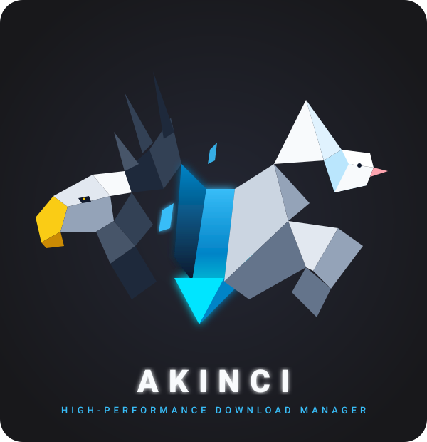
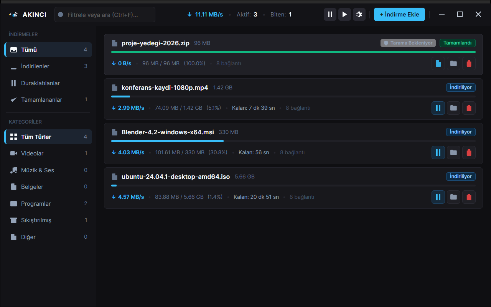

<p align="right"><b>English</b> · <a href="README.tr.md">Türkçe</a></p>

# AKINCI
### Multi-connection, high-performance download manager with built-in security checks

<p align="center">
  
</p>

<p align="center">
  <a href="CHANGELOG.md"></a>
  <a href="LICENSE-MIT"></a>
  <a href="LICENSE"></a>
</p>

<p align="center">
  <a href="https://github.com/devutku/akinci/releases/latest"><b>Download</b></a> ·
  <a href="https://chromewebstore.google.com/detail/coeeghhijegibfhhodhnjhjffaipckok">Browser extension</a> ·
  <a href="https://devutku.github.io/akinci/">Website</a> ·
  <a href="CHANGELOG.md">Changelog</a>
</p>

<p align="center">
  
</p>

> **Language:** The desktop app is available in English and Turkish. It follows your Windows display language, and you can change it under **Settings → Dil / Language**.

---

## ⚡ Overview

**Akıncı** is a free, open-source download manager built on **.NET 10** and **Avalonia**. It splits each file into parallel parts, downloads them over multiple connections at once and stitches them back together. No ads, no telemetry.

- **Multi-connection downloads:** up to 32 parallel parts per file. Connections that finish early take over the remaining work of slower parts.
- **Resume:** dropped connections are retried automatically. Closing the app pauses and saves running downloads, so they continue where they left off.
- **VirusTotal check:** when a download finishes, its SHA-256 hash is looked up against 70+ antivirus engines. The file itself is never uploaded.
- **Browser integration:** a Chrome/Edge extension hands downloads over to Akıncı, adds *"Download with Akıncı"* to the context menu and detects HLS video streams.
- **Speed limit & queue:** global bandwidth limit and a configurable number of simultaneous downloads.
- **Enterprise networks:** Basic, NTLM, Kerberos and Negotiate (SPNEGO) authentication, plus your Windows sign-in credentials.
- **Command line:** a separate CLI with a live per-part progress view.

The core of the app (Domain and Application layers) follows **Clean Architecture / Hexagonal Architecture** and is fully isolated from HTTP, disk I/O, SQLite and the UI framework.

---

## 🦅 Protocols and Authentication

| Protocol | Details |
|---|---|
| **HTTP / HTTPS** | High-performance `SocketsHttpHandler`, Range requests, automatic redirect following |
| **FTP / FTPS** | Secure transfers via `FluentFTP`, per-part downloads using REST offsets |
| **HLS** | Live and VOD `.m3u8` streams, including master playlists |

### Authentication
* **Basic**
* **NTLM** (Windows network authentication)
* **Kerberos**
* **Negotiate (SPNEGO)**
* Windows sign-in credentials (`DefaultCredentials`)

---

## 💿 Installation

### Windows

1. Download `Akinci-Setup-<version>.exe` from the [Releases](https://github.com/devutku/akinci/releases/latest) page and run it.
2. The installer is not code-signed yet, so Windows SmartScreen may show *"Windows protected your PC"*. Click **More info → Run anyway**.
3. Follow the wizard. No administrator rights are needed: Akıncı installs for your user only, under `%LOCALAPPDATA%\Programs\Akinci`. If you have a VirusTotal API key you can enter it in the wizard, or add it later in **Settings**.

To uninstall, pick *Akıncı* in **Control Panel → Programs and Features** (or **Settings → Apps**). Uninstalling never touches your downloaded files. You are asked whether to also remove settings and download history.

A portable `.zip` is published with every release for those who prefer not to use the installer.

### Linux and macOS

Each release also includes `linux-x64`, `osx-x64` and `osx-arm64` archives (`.tar.gz`). Extract one and run `Akinci.UI/Akinci` (desktop app) or `Akinci.Cli/Akinci-CLI` (command line).

### VirusTotal API key

Scanning needs a free [VirusTotal](https://www.virustotal.com/) account. Copy the API key from your account page into the installer or **Settings**. Without a key, downloads work normally and are simply not checked.

---

## 🌐 Browser Integration

The extension is published on the **[Chrome Web Store](https://chromewebstore.google.com/detail/coeeghhijegibfhhodhnjhjffaipckok)** and works in Chrome and Edge:

1. Accept the setup prompt Akıncı shows on first launch (or **Settings → Install Extension**). Akıncı registers the browser bridge and opens the store page.
2. Click **Add to Chrome**. In Edge, first allow *"extensions from other stores"*.

For development, the `src\Akinci.NativeHost\extension` folder can be loaded with **Load unpacked** in developer mode (it uses a fixed development ID).

---

## ⌨️ Command Line

```text
Akinci-CLI <URL> [options]

  -o, --output <dir>         Destination directory (default: current directory)
  -c, --connections <n>      Number of parallel connections/parts (default: 8)
  -n, --name <name>          Custom file name
  -u, --user <user>          Username for authentication
  -p, --pass <password>      Password for authentication
  -a, --auth <type>          basic, ntlm, kerberos or negotiate
  --vt-key <key>             VirusTotal API key (default: $VIRUSTOTAL_API_KEY)
```

Example:

```bash
Akinci-CLI https://example.com/file.iso -c 16 -o downloads
```

---

## 🏛 Architecture

```plaintext
Akinci/
├── src/
│   ├── Akinci.Domain/             # Pure C#, no external packages (entities, value objects, enums)
│   ├── Akinci.Application/        # Use cases, DTOs, port interfaces (hexagonal ports)
│   ├── Akinci.Infrastructure/     # SocketsHttpHandler, RandomAccess I/O, SQLite WAL, VirusTotal API
│   ├── Akinci.Cli/                # Terminal app with a live ASCII per-part progress view
│   ├── Akinci.UI/                 # Avalonia UI, dark theme, MVVM, system tray
│   └── Akinci.NativeHost/         # Native Messaging host for Chrome/Edge/Firefox
└── tests/
    ├── Akinci.Domain.UnitTests/
    ├── Akinci.Application.UnitTests/
    └── Akinci.Infrastructure.IntegrationTests/
```

---

## 🛠 Building from Source

Requires the [.NET 10 SDK](https://dotnet.microsoft.com/download). Both scripts produce self-contained single-file executables.

### Windows

```bat
publish.bat
```

Output goes to `dist/`:
* `dist\Akinci\Akinci.exe` (desktop app)
* `dist\Akinci\Akinci-CLI.exe` (command line)
* `dist\Akinci\Akinci-BrowserBridge.exe` (browser bridge)
* `dist\Akinci-Setup-<version>.exe` (installer; built only if [Inno Setup 6](https://jrsoftware.org/isinfo.php) is installed: `winget install --id JRSoftware.InnoSetup -e`)

### Linux and macOS

```bash
./publish.sh linux-x64
```

---

## ⚖️ Licensing (Dual License)

Akıncı uses a **dual license** that keeps the engine free to reuse while making sure the desktop app cannot be cloned into a closed-source product:

* **Core libraries (`Akinci.Domain`, `Akinci.Application`, `Akinci.Infrastructure`):**
  licensed under the **[MIT License](LICENSE-MIT)**, so developers can use the download engine in their own projects, including commercial ones.
* **Desktop app and distributions (`Akinci.UI`, the CLI and bundled binaries):**
  licensed under the **[GNU General Public License v3.0 (GPLv3)](LICENSE)**.

> You can use the download engine freely as a library, but the Akıncı desktop app and anything derived from it must stay open source.

Privacy: see [PRIVACY.md](PRIVACY.md). Code signing: see the [code signing policy](https://devutku.github.io/akinci/code-signing-policy.html).

---

## ⚠️ Disclaimer

> Akıncı is a networking tool built for education and open data transfer. Users are responsible for downloading copyrighted content or content that violates a platform's terms of service.
